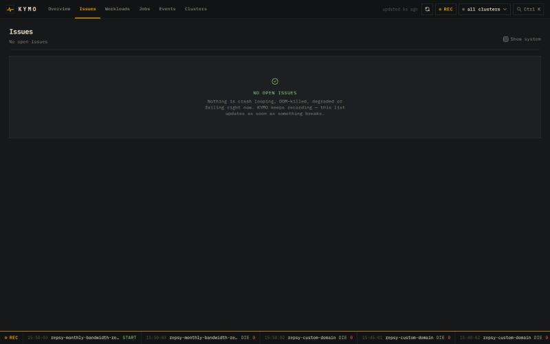
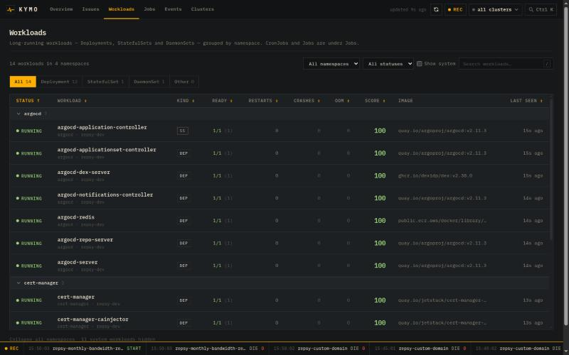
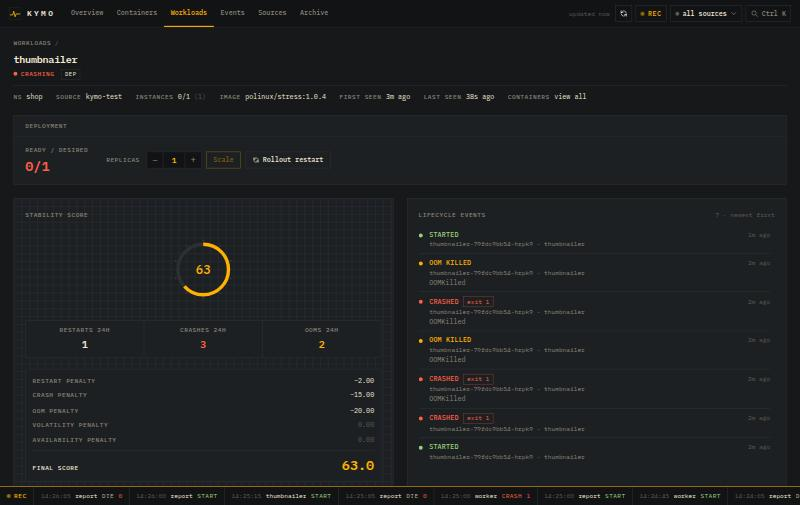

# KYMO

[](https://github.com/emirhanusta/kymo/actions/workflows/ci.yml)

A recorder for container lifecycles. KYMO watches Kubernetes clusters
(Kubernetes-only for now), records every start, crash, OOM kill and resource sample in
TimescaleDB, and turns that history into a stability score per container —
like a kymograph tracing a needle over chart paper.


## What it does

- **Workload-level history** — every pod a Deployment, StatefulSet, DaemonSet,
  CronJob or Job ever ran is aggregated into one workload, so crashes, OOM
  kills, restarts and the stability score survive rollouts and rescheduling.
  Pods killed by a rollout or scale-down are recorded as stops, not crashes.
- **Lifecycle history** — start / stop / crash / OOM events per container,
  with exit codes and reasons, kept across restarts of KYMO itself.
- **Resource traces** — CPU, memory and network rates over 1h / 6h / 24h / 7d
  (long ranges are downsampled server-side).
- **Stability score (0–100)** — penalties for restarts, crashes, OOM kills,
  CPU volatility and reporting gaps over a configurable window.
- **Sources from the UI** — add, edit, pause and remove Kubernetes
  clusters at runtime, with a connection test before saving. Mark a
  source read-only to disable every management action for it. Unreachable
  sources are retried in the background and shown as such.
- **Management** — restart (delete) pods, scale and restart Deployments,
  stream pod logs.
- **Kubernetes extras** — workload detection (Deployment, Job, CronJob, …) and
  CronJob execution history.
- **Archive / ignore** — hide containers without losing their history, or stop
  tracking them entirely.

| | |
|---|---|
|  |  |
|  |  |

## Quick start (Docker Compose)

```bash
export KYMO_SECRET_KEY=$(openssl rand -hex 32)   # keep it; needed to decrypt stored kubeconfigs
docker compose up -d --build
```

This starts TimescaleDB and KYMO (the compose file only runs KYMO itself; it
does not monitor Docker). Open <http://localhost:8080>. With no sources
configured KYMO starts empty — add a Kubernetes source on the **Sources**
page by pasting a kubeconfig (requires `KYMO_SECRET_KEY`). Alternatively mount
a `config.yaml` at `/etc/kymo/config.yaml` plus the kubeconfig it references
(see the commented `volumes` in `docker-compose.yml` and
[`config.example.yaml`](config.example.yaml)).

## Run inside Kubernetes (Helm)

KYMO can run in the cluster it monitors using the in-cluster ServiceAccount
(no kubeconfig). The chart in [`deploy/helm/kymo`](deploy/helm/kymo) installs
KYMO with read-only cluster RBAC and a bundled TimescaleDB:

```bash
helm install kymo deploy/helm/kymo -n kymo --create-namespace
kubectl -n kymo port-forward svc/kymo 8080:8080
```

See the [chart README](deploy/helm/kymo/README.md) for external databases,
ingress, notification channels and all values. To try it on minikube without a
registry, build the image into the cluster and skip pulling:

```bash
minikube image build -t ghcr.io/emirhanusta/kymo:0.1.0 .
helm install kymo deploy/helm/kymo -n kymo --create-namespace --set image.pullPolicy=Never
```

Tagging `v*` publishes a multi-arch image to `ghcr.io/emirhanusta/kymo`.

## Running locally

Requirements: Go 1.24+, Node 20+, a TimescaleDB instance.

```bash
cp config.example.yaml config.yaml   # adjust sources / DSN
make web                             # build the UI into frontend/dist
make run                             # API + collectors (set server.static_dir to serve the UI)
```

For frontend development run `make web-dev` (Angular dev server on :4200,
proxying `/api` to :8080). Database migrations are applied automatically on
startup; `make migrate DSN=...` applies them by hand.

## Configuration

Only Kubernetes sources are supported for now; a source of any other type is
rejected. With no sources configured KYMO starts empty. Sources can be
declared in `config.yaml` (locked in the UI) or managed on the
**Sources** page. You can point at a kubeconfig file on the
server, or paste/upload one — uploads are stored encrypted and require
`KYMO_SECRET_KEY` to be set.

**Live reload:** the `collector.sources` list in `config.yaml` is applied while
KYMO runs — the file is watched, and you can also press *Reload config.yaml* on
the Sources page or `POST /api/v1/sources/reload`. Added, changed and removed
sources take effect immediately (recorded history is kept); an invalid file is
rejected and the current sources keep running. The notification channels and
`log_capture` (targets, patterns, limits) are applied live too. All other
settings (server, auth, database, log, secret key, poll and scoring intervals,
`issues`, `log_capture.retention`) still need a restart.

See [`config.example.yaml`](config.example.yaml). Every key can be overridden
with an environment variable prefixed `KYMO_`, e.g. `KYMO_DATABASE_DSN`,
`KYMO_COLLECTOR_SCORING_WINDOW`.

Kubernetes sources need a kubeconfig; CPU/memory sampling requires
metrics-server in the cluster.

**Crash-log snapshots:** when a container crashes or is OOM-killed (not on
pod deletion or clean exit), KYMO fetches the tail of that container
instance's logs and stores it for 30 days, so you can see what it printed
before it died. Configure with `collector.crash_logs.enabled` (default
`true`), `collector.crash_logs.tail_lines` (default 200, max 2000) and
`collector.crash_logs.max_bytes` (default 65536, max 1 MiB). Logs can contain
sensitive data — set `enabled: false` to disable. The source's kubeconfig needs
`get` on `pods/log`. API: `GET /api/v1/workloads/:id/crash-logs`,
`GET /api/v1/containers/:id/crash-logs[?occurred_at=...]`.

**Kubernetes Events:** events expire in the cluster after about an hour, so
KYMO persists them (90 days) and links each to its workload where it can (Pod,
ReplicaSet, Deployment, StatefulSet, DaemonSet, Job, CronJob). `Warning` events
are always kept; `Normal` events only for the reasons in
`collector.k8s_events.normal_reasons` (default: ScalingReplicaSet,
SuccessfulCreate, SuccessfulDelete, Killing, SawCompletedJob, SuccessfulRescale,
Preempted, Rebooted, NodeNotReady, RegisteredNode, RemovingNode, Evicted).
`collector.k8s_events.enabled` (default `true`) and
`collector.k8s_events.exclude_namespaces` (default none) control the rest. The
source's kubeconfig needs `list` and `watch` on `events` (core API group,
cluster-wide). API: `GET /api/v1/k8s-events[?source&namespace&type&reason&workload_id&q&since&before&limit]`,
`GET /api/v1/workloads/:id/k8s-events`, `GET /api/v1/k8s-events/reasons[?source&since]`.

**Error log capture:** see [below](#error-log-capture).

**Revisions:** each container records its pod's revision
(`pod-template-hash`, `controller-revision-hash`, or the Job name);
`GET /api/v1/workloads/:id/revisions` lists rollouts newest first.

## Accounts & SSO

KYMO requires a sign-in by default (`auth.enabled: true`). One installation has
one organisation; roles are global:

| Role | Can |
|---|---|
| viewer | read everything (overview, workloads, issues, errors, logs, clusters, settings) |
| operator | viewer + restart pods, scale / rollout-restart deployments, ignore / restore containers, toggle log capture |
| admin | operator + clusters (add/edit/remove/purge/reload), notification channels, permanent deletes and purges, users, invites, other people's API tokens, audit log |
| owner | admin + promote/demote admins, transfer ownership (exactly one owner) |

**Sign-in identity.** Users sign in with a **username** (or their email, if they
have one); email is optional and KYMO never sends mail. Usernames are lower-case
(`[a-z0-9][a-z0-9._-]{1,63}`) and unique.

**First run: the initial admin account.** When KYMO starts with no users it
creates an owner account:

- With `KYMO_ADMIN_PASSWORD` set (12+ characters): username `KYMO_ADMIN_USERNAME`
  (default `admin`), optional `KYMO_ADMIN_EMAIL` / `KYMO_ADMIN_NAME`, and
  `KYMO_ADMIN_MUST_CHANGE_PASSWORD=true` to force a change at first sign-in
  (default `false`).
- Otherwise: owner `admin` with a random 24-character password that must be
  changed at first sign-in. It is logged once:

  ```sh
  kubectl logs deploy/kymo | grep "initial admin"     # or: docker compose logs kymo | grep "initial admin"
  # initial admin account created: username "admin", password "...." — sign in and change it
  ```

The variables are ignored once any user exists. While an account must change
its password, its session can only reach the change-password page (and
profile / sign-out); every other API call answers `403 password_change_required`.
The Helm chart generates the password into its Secret instead (see the chart README).
Passwords are stored as argon2id hashes.

**Lockout recovery.** Reset any account's password from the server (same
config/database; all its sessions are signed out):

```sh
kymo admin reset-password --username admin                     # prompts twice (or --email you@example.com)
echo 'new-long-password' | kymo admin reset-password --username admin --password-stdin
# in a container the binary is /kymo:
kubectl exec -it deploy/kymo -- /kymo admin reset-password --username admin
```

**Users.** Admins invite people by username, with an optional email
(`Settings -> Users`): the invite link is valid 7 days and is shared by hand
(no email is sent); the invitee picks a name and password. Everyone can edit
their name and email under the user menu -> Profile; admins can set a user's email. Admins can also create 1-hour
password-reset links, disable users (history is kept) and change roles. API
tokens (`Authorization: Bearer kymo_<prefix>_<secret>`, shown once, never above
the creator's role) are for scripts; every sensitive action ends up in the
audit log (kept one year; `Settings -> Audit`).

**Security model.** Sessions use the `kymo_session` cookie (HttpOnly,
SameSite=Lax, `Secure` when `server.public_url` is https), expire after 7 days
idle / 30 days absolute and are revoked on password, role or status change.
Login is limited to 10 failures per 15 minutes per IP and per login (username or email). Mutating
API calls need the `X-KYMO-Request: 1` header and a matching `Origin` (API-token
calls are exempt). CORS is same-origin only; list extra browser origins in
`server.allowed_origins`. Behind a reverse proxy also set
`server.trusted_proxies` so the real client IP is used.

**Single sign-on (OpenID Connect).** Authorization-code flow with PKCE, state
and nonce. Register `<server.public_url>/api/v1/auth/oidc/callback` as the
redirect URL at the provider; `server.public_url` is required (KYMO refuses to
start otherwise). The ID token must contain a verified `email`. Users are matched
by (issuer, subject), then linked to an existing user whose stored email equals
the verified email. New users get their username from `preferred_username`,
else the email local part, else `user` (sanitised, and `-2`, `-3`... on clashes). With `role_mapping`, the role is re-synced from the groups claim at every
login (highest match wins, `default_role` otherwise); the owner is never
demoted by SSO. `auto_create: false` requires an invite first.
`disable_password_login: true` makes it SSO-only (use `reset-password` only for
recovery).

```yaml
server:
  public_url: "https://kymo.example.com"
auth:
  oidc:
    enabled: true
    name: "Google"
    issuer: "https://accounts.google.com"
    client_id: "1234.apps.googleusercontent.com"
    client_secret: ""              # KYMO_AUTH_OIDC_CLIENT_SECRET
    allowed_domains: ["example.com"]
    default_role: "viewer"
```

Google: create an OAuth client of type *Web application*, add the redirect URL
above. Google has no groups claim, so use `allowed_domains` and `default_role`
(promote people in the UI).

```yaml
auth:
  oidc:
    enabled: true
    name: "Keycloak"
    issuer: "https://keycloak.example.com/realms/acme"
    client_id: "kymo"
    scopes: ["openid", "email", "profile"]
    groups_claim: "groups"          # add a "Group Membership" mapper (full path off) to the client
    role_mapping:
      admin: ["kymo-admins"]
      operator: ["sre"]
    default_role: "viewer"
```

Keycloak: a confidential client with *Standard flow* on and the redirect URL
above; the groups mapper must add the claim to the **ID token**. Realm roles
work with `groups_claim: "realm_access.roles"`.

**Local development without sign-in:** `auth.enabled: false` (or
`KYMO_AUTH_ENABLED=false`) makes every request the owner and logs a loud
warning. Never expose KYMO like that.

## Issues and notifications

**Issues:** every `issues.evaluate_interval` (default 30s) KYMO evaluates all
workloads of the *registered* clusters (removed clusters and, unless
`issues.include_system: true`, system workloads are ignored) and keeps one
persistent issue per workload and type:

| type | severity | opens when |
| --- | --- | --- |
| `crash_loop` | critical | workload is crashing (not explained by OOM), title "Crash loop · exit N" |
| `oom` | critical | at least one OOM kill in the last 24h, "OOMKilled ×N in 24h" |
| `degraded` | warning | fewer pods running than active for `issues.degraded_after` (3m) |
| `job_failed` | critical | a CronJob's latest finished run failed |
| `cant_schedule`, `image_pull`, `evicted`, `volume_mount` | critical | Warning Kubernetes events from the last 30 min (FailedScheduling, ErrImagePull/ImagePullBackOff, Evicted, FailedMount/FailedAttachVolume) |
| `probe_failing` | warning | Unhealthy events from the last 30 min |
| `error_rate` | warning | captured error log lines of the last 5 min reach `issues.error_rate_threshold` (default 20), "Error logs ×N in 5m", detail = the top signature (needs [error log capture](#error-log-capture)) |

An issue resolves once its condition has been gone for `issues.resolve_after`
(5m). If the problem returns within `issues.reopen_window` (15m) the *same*
issue reopens (counted in `flaps`, no second "opened" notification). Resolved
issues are kept for 90 days. API: `GET /api/v1/issues[?status=open|resolved|all&source&severity&type&limit&before]`,
`GET /api/v1/issues/summary`, `GET /api/v1/issues/:id`,
`GET /api/v1/workloads/:id/issues[?status]`. For `status=resolved` the `before`
cursor is compared with `resolved_at`, otherwise with `first_seen`.

**Notifications:** channels (Slack incoming webhook, Discord webhook, generic
webhook) receive *opened*, *resolved* and optional *reminder* messages. Each
channel filters by minimum severity, cluster, namespace and issue type, and can
attach the last 20 lines of the newest crash log (`include_logs`).
Deliveries time out after 10s, are retried up to 3 times (1s, 5s back-off) and
every attempt series is logged (30 days) - see the channel's delivery log in
the UI or `GET /api/v1/notifications/deliveries`.

- Create channels in the UI or with `POST /api/v1/notifications/channels`
  (`name`, `type`, `url`, optional `secret`, `min_severity`, `sources`,
  `namespaces`, `types`, `notify_resolved`, `include_logs`, `repeat_minutes`).
  The URL (and webhook secret) is stored AES-GCM encrypted and never returned by
  the API (only a hint such as `hooks.slack.com/…/abcd`), so the server needs
  `KYMO_SECRET_KEY`; without it creating a channel returns 400.
- Or declare channels under `notifications.channels` in `config.yaml` (see
  `config.example.yaml`). They need no secret key and are locked in the UI, but
  the URL is **plain text in the file** - keep it private. Changes apply live.
- `POST /api/v1/notifications/channels/:id/test` sends a sample message and
  returns `{ok, status_code, error}`.
- **Slack:** Apps > Incoming Webhooks > add a webhook, copy
  `https://hooks.slack.com/services/...`. **Discord:** channel settings >
  Integrations > Webhooks, copy `https://discord.com/api/webhooks/...`.
- URLs must be https (plain http only for `localhost` / `127.0.0.1`, for
  testing).
- Set `server.public_url` (e.g. `https://kymo.example.com`) to get an "Open in
  KYMO" link to `<public_url>/workloads/<workload id>` in every message.
  `notifications.enabled: false` silences all sending.

**Generic webhook payload:** `POST` with JSON
`{"event": "opened|resolved|reminder|test", "issue": {...}, "workload_url": "...", "crash_log_tail": "...", "sent_at": "..."}`
and the header `X-KYMO-Event`. With a secret the body is signed:
`X-KYMO-Signature: sha256=<hex HMAC-SHA256 of the raw body>`. Verify it, e.g.:

```python
import hmac, hashlib

def valid(secret: bytes, body: bytes, header: str) -> bool:
    expected = "sha256=" + hmac.new(secret, body, hashlib.sha256).hexdigest()
    return hmac.compare_digest(expected, header)
```

```go
mac := hmac.New(sha256.New, secret)
mac.Write(body) // the raw request body
ok := hmac.Equal([]byte("sha256="+hex.EncodeToString(mac.Sum(nil))), []byte(r.Header.Get("X-KYMO-Signature")))
```

> **Security note:** the API exposes management actions (delete pod, scale,
> rollout restart). Access is controlled by [accounts and roles](#accounts--sso);
> only turn authentication off (`auth.enabled: false`) on a trusted local machine,
> and be careful which kubeconfig context a source uses.

## Error log capture

Opt-in: KYMO follows the log stream of the **running** containers of the
workloads you enable, keeps only error-level lines (with their stack traces),
groups them into **signatures** and stores counts plus a few masked samples.
Nothing is captured until you opt in.

> **Privacy:** container logs can contain sensitive data (tokens, personal
> data, ...). Captured lines are masked before they are stored (Bearer/Basic
> tokens, `password=` / `secret` / `token` / `api_key` pairs, AWS access keys,
> JWTs, URL credentials, 13-19 digit card-like numbers become `***`), but
> masking is **best-effort** and cannot recognise every secret. Enable capture
> only for workloads whose logs you are allowed to store, and keep the
> database and the API private. Read-only sources can capture too (it only
> reads logs); the source's RBAC needs `get` on `pods/log`.

**Opting in** (any one is enough):

1. the workload's *Error logs* toggle in the UI, or a namespace target
   (`POST /api/v1/log-capture/targets`, stored in the database);
2. the pod template annotation `kymo.io/capture-error-logs: "true"`;
3. `log_capture.targets` in `config.yaml` (read-only in the UI, reloaded live).

**What is an error:** JSON lines with `level` / `severity` / `lvl` of error,
fatal, ... (or pino/bunyan numbers >= 50), logfmt `level=error`, klog `E...` /
`F...` lines, plain text with an `ERROR` / `FATAL` / `PANIC` / `CRITICAL` /
`[error]` level token near the start, `panic:` / `fatal error:`, Python
`Traceback`, Java `Exception in thread` / `...Exception:` lines and Node
`...Error:` lines. The first level word wins, so an `INFO` line that merely
contains the word "error" is ignored, and a structured level always decides.
`log_capture.extra_patterns` (regexes that also mark a line as an error) and
`log_capture.ignore_patterns` (regexes that discard a line) refine this.
Stack traces (indented lines, `at ...`, `Caused by`, `... N more`, Python
tracebacks, Go panic/goroutine dumps) are attached to their error line: up to
50 lines, closed after 200 ms without a new line.

**Signatures:** the first line is normalised (timestamps, UUIDs, hex ids, IPs,
numbers, quoted strings and e-mail addresses become `<ts> <uuid> <hex> <ip> <n>
<str> <email>`, level prefixes are stripped) and hashed with the workload id, so
"order 17 failed" and "order 9001 failed" are one signature with a count.
Per signature KYMO keeps per-minute counts (exact totals), the pods affected and
the newest `samples_per_signature` masked occurrences (default 50, each up to
8 KB).

**Limits** (`log_capture.*`): `max_streams_per_source` (default 50 containers per
source, oldest container first), `max_lines_per_minute` (default 600 error
entries per container; the excess is dropped and shown as *dropped lines* in
`GET /api/v1/log-capture/status`), single lines are cut at 8 KB, `retention`
(default `7d`) for counts and occurrences, `enabled: false` is a global kill
switch. Targets, patterns and limits are applied live (UI, API and config
reload) without restarting a source; `retention` is applied at startup.

**API** (all under `/api/v1`): `GET|POST /log-capture/targets`,
`DELETE /log-capture/targets/:id` (403 for config targets),
`GET|PUT /workloads/:id/log-capture` (`{enabled}`; 409 with `via` when it is
enabled through a namespace target, annotation or config),
`GET /log-capture/status`, `GET /errors[?source&namespace&workload_id&since=1h|6h|24h|7d&limit]`,
`GET /workloads/:id/errors`, `GET /errors/:id`,
`GET /errors/:id/occurrences[?limit&before]`.

## Keyboard

| Key | Action |
|---|---|
| `⌘K` / `Ctrl+K` | Command palette — jump to any page or container |
| `1`–`6` | Switch tabs |
| `/` | Focus the search box |
| `Esc` | Close dialogs |

## Project layout

```
cmd/kymo            entry point
internal/collector  Kubernetes collector
internal/service    recorder (event pipeline, scoring loop) and management actions
internal/repository TimescaleDB persistence + embedded migration runner
internal/handler    REST API (/api/v1) and SPA serving
migrations          SQL schema (embedded into the binary)
frontend            Angular web UI
```

## Development

```bash
make test    # go test -race ./...
make lint    # golangci-lint
make test-db # repository integration tests against a throwaway TimescaleDB (needs Docker)
```

The integration tests in `internal/repository/timescale` skip unless
`KYMO_TEST_DSN` is set, so plain `go test ./...` stays fast. `make test-db`
starts a disposable `timescale/timescaledb` container on port 55433, runs the
tests against it and always removes the container. To use your own server, set
`KYMO_TEST_DSN` to a DSN whose user may `CREATE DATABASE`; each run creates and
drops its own `kymo_test_<random>` database and never touches any other.
