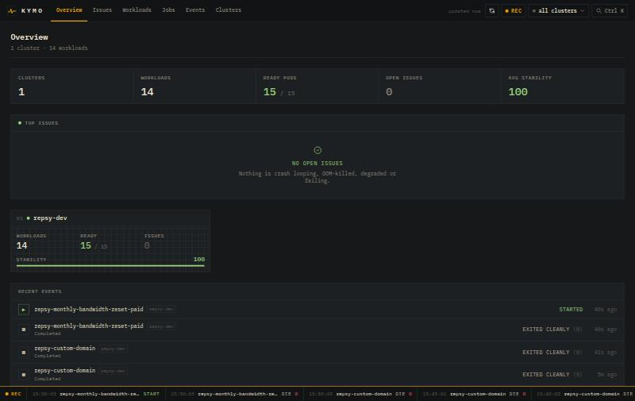
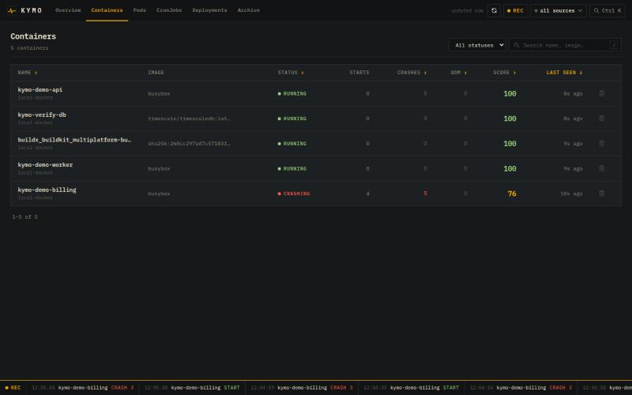
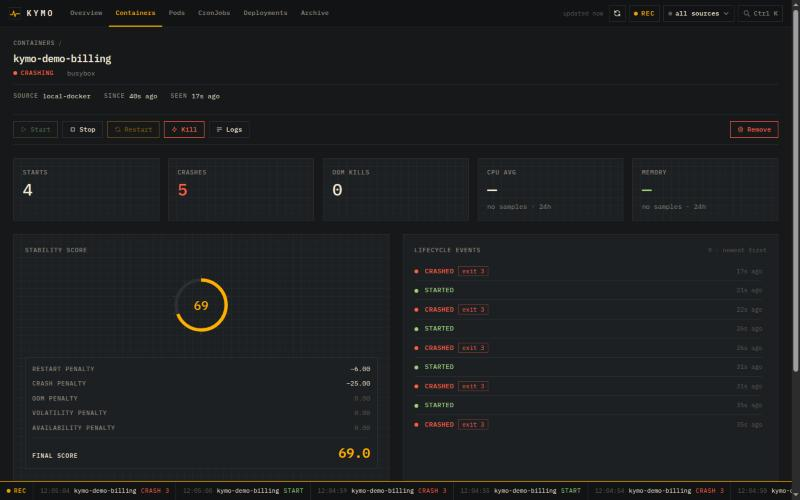
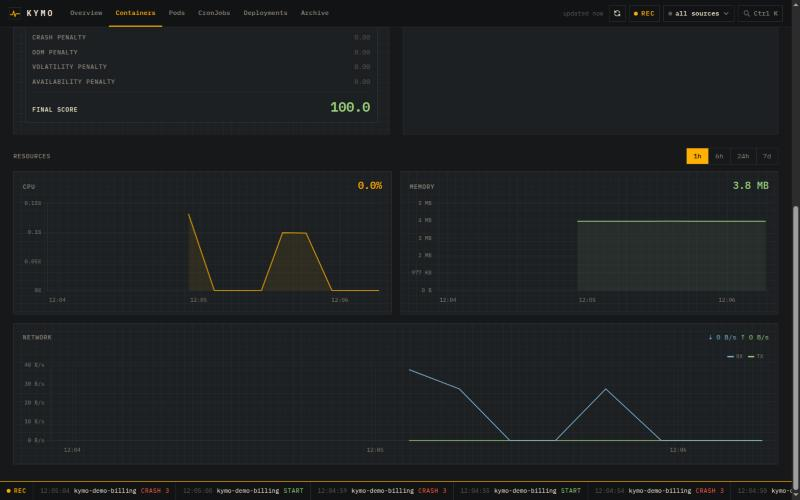
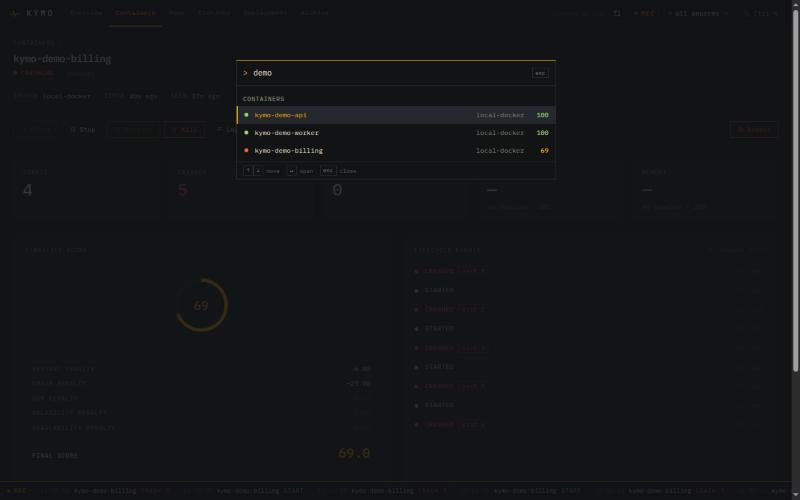
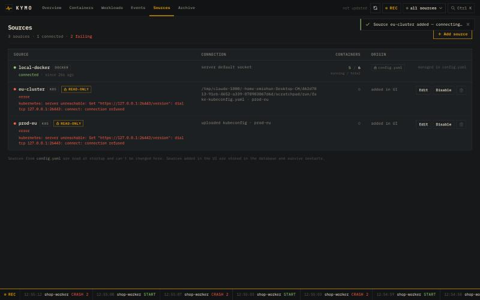
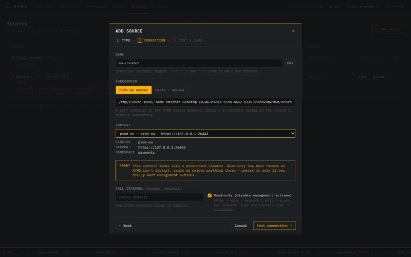
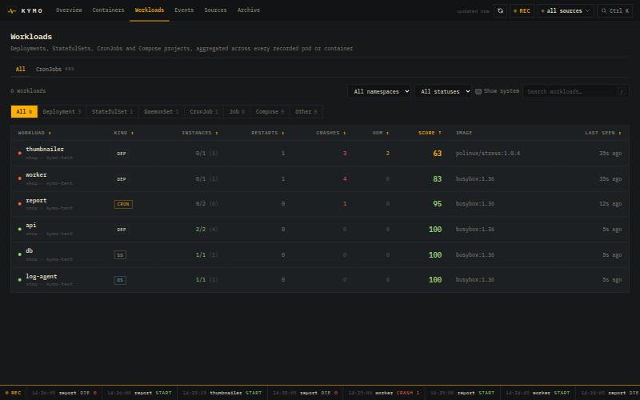
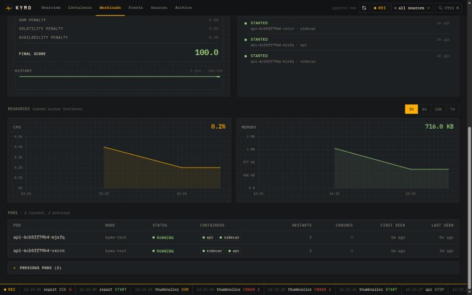
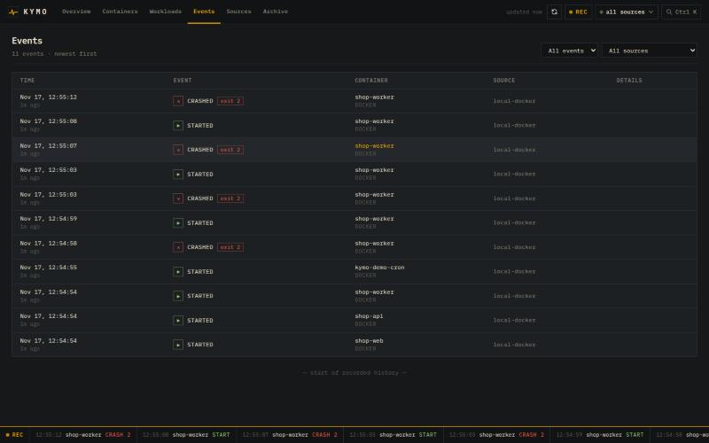

# KYMO

A recorder for container lifecycles. KYMO watches Docker daemons and Kubernetes
clusters, records every start, crash, OOM kill and resource sample in
TimescaleDB, and turns that history into a stability score per container —
like a kymograph tracing a needle over chart paper.



## What it does

- **Workload-level history** — every pod a Deployment, StatefulSet, DaemonSet,
  CronJob or Job ever ran is aggregated into one workload, so crashes, OOM
  kills, restarts and the stability score survive rollouts and rescheduling.
  Pods killed by a rollout or scale-down are recorded as stops, not crashes.
- **Lifecycle history** — start / stop / crash / OOM events per container,
  with exit codes and reasons, kept across restarts of KYMO itself.
- **Resource traces** — CPU, memory and network rates over 1h / 6h / 24h / 7d
  (long ranges are downsampled server-side).
- **Stability score (0–100)** — penalties for restarts, crashes, OOM kills,
  CPU volatility and reporting gaps over a configurable window.
- **Sources from the UI** — add, edit, pause and remove Docker daemons and
  Kubernetes clusters at runtime, with a connection test before saving. Mark a
  source read-only to disable every management action for it. Unreachable
  sources are retried in the background and shown as such.
- **Management** — start / stop / restart / kill Docker containers, delete
  pods, scale and restart Deployments, stream logs.
- **Kubernetes extras** — workload detection (Deployment, Job, CronJob, …) and
  CronJob execution history.
- **Archive / ignore** — hide containers without losing their history, or stop
  tracking them entirely.

| | |
|---|---|
|  |  |
|  |  |
|  |  |
|  |  |
|  |  |

## Quick start (Docker Compose)

```bash
docker compose up -d --build
```

Open <http://localhost:8080>. With no config file mounted, KYMO watches the
local Docker daemon. The service runs as a non-root user, so it needs the
Docker socket's group:

```bash
DOCKER_GID=$(stat -c '%g' /var/run/docker.sock) docker compose up -d --build
```

## Running locally

Requirements: Go 1.24+, Node 20+, a TimescaleDB instance.

```bash
cp config.example.yaml config.yaml   # adjust sources / DSN
make web                             # build the UI into frontend/dist
make run                             # API + collectors (set server.static_dir to serve the UI)
```

For frontend development run `make web-dev` (Angular dev server on :4200,
proxying `/api` to :8080). Database migrations are applied automatically on
startup; `make migrate DSN=...` applies them by hand.

## Configuration

Sources can be declared in `config.yaml` (locked in the UI) or managed on the
**Sources** page. For Kubernetes you can point at a kubeconfig file on the
server, or paste/upload one — uploads are stored encrypted and require
`KYMO_SECRET_KEY` to be set.

**Live reload:** the `collector.sources` list in `config.yaml` is applied while
KYMO runs — the file is watched, and you can also press *Reload config.yaml* on
the Sources page or `POST /api/v1/sources/reload`. Added, changed and removed
sources take effect immediately (recorded history is kept); an invalid file is
rejected and the current sources keep running. All other settings (server,
database, log, secret key, poll and scoring intervals) still need a restart.

See [`config.example.yaml`](config.example.yaml). Every key can be overridden
with an environment variable prefixed `KYMO_`, e.g. `KYMO_DATABASE_DSN`,
`KYMO_COLLECTOR_SCORING_WINDOW`.

Kubernetes sources need a kubeconfig; CPU/memory sampling requires
metrics-server in the cluster.

> **Security note:** the API has no authentication and exposes management
> actions (kill, delete pod, scale). Run it on a trusted network or behind an
> authenticating proxy, and be careful which kubeconfig context a source uses.

## Keyboard

| Key | Action |
|---|---|
| `⌘K` / `Ctrl+K` | Command palette — jump to any page or container |
| `1`–`6` | Switch tabs |
| `/` | Focus the search box |
| `Esc` | Close dialogs |

## Project layout

```
cmd/kymo            entry point
internal/collector  Docker and Kubernetes collectors
internal/service    recorder (event pipeline, scoring loop) and management actions
internal/repository TimescaleDB persistence + embedded migration runner
internal/handler    REST API (/api/v1) and SPA serving
migrations          SQL schema (embedded into the binary)
frontend            Angular web UI
```

## Development

```bash
make test    # go test -race ./...
make lint    # golangci-lint
```
