# KYMO

**A flight recorder for Kubernetes workloads.** KYMO keeps the lifecycle history that Kubernetes throws away: starts, stops, crashes, OOM kills, resource usage and error logs, per workload, across rollouts and pod replacements.

[](https://github.com/emirhanusta/kymo/actions/workflows/ci.yml)
[](LICENSE)

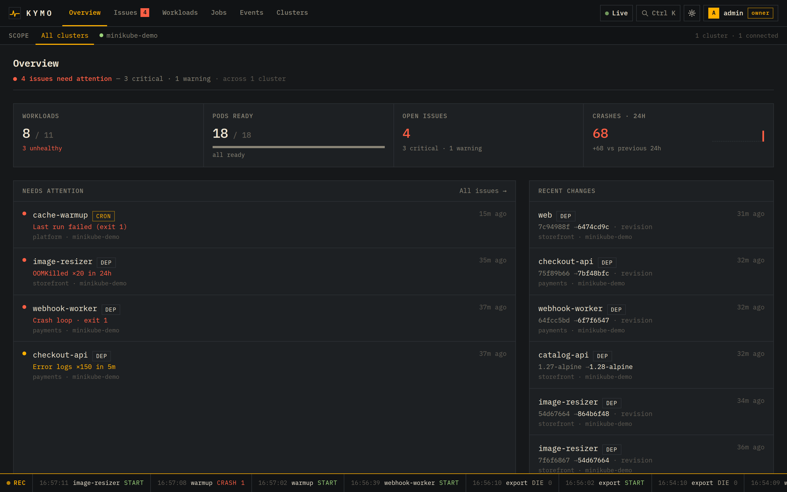

## Why KYMO

Kubernetes forgets. Pods are replaced, restart counters reset with them, and cluster events expire after about an hour, so the question "what happened to this service last night?" often has no answer by morning. KYMO watches your clusters continuously and stores the lifecycle of every container in TimescaleDB, aggregated per workload instead of per pod. It then turns that history into a stability score and into issues that open and resolve on their own, with notifications to Slack, Discord or a webhook.

## Features

**Recording**
- **Container lifecycle.** Pods are watched with client-go informers. Start, stop, crash and OOM-kill events are stored with exit codes and reasons, together with CPU and memory samples from `metrics.k8s.io`.
- **Workload-level history.** Deployments, StatefulSets, DaemonSets, CronJobs and Jobs are aggregated across their pods and rollouts. Pods removed by a rollout or scale-down count as stops, not crashes, and finished Job pods are never reported as crashing. Revision tracking feeds a "recent changes" view.
- **Crash logs.** The tail of a container's logs is captured when it crashes or is OOM-killed, so you can read what it printed before it died.
- **Kubernetes events.** Events are persisted for 90 days and linked to their workload.
- **Opt-in error-log capture.** Enable it per workload in the UI or with the pod annotation `kymo.io/capture-error-logs: "true"`. Error lines are detected, normalized, masked (ids, IPs, emails, tokens) and grouped into signatures with counts and samples.

**Analysis**
- **Stability score (0-100)** per workload, based on restarts, crashes, OOM kills, CPU volatility and reporting gaps.
- **Issues engine.** Crash loop, OOM, degraded, failed CronJob, image pull, cannot schedule, evicted, volume mount, probe failing and error rate. Issues resolve automatically once the condition is gone, and a quick relapse reopens the same issue instead of creating a new one.
- **Jobs and CronJobs.** Schedule, next run (timezone-aware), run history and success rate.
- **Notifications.** Slack, Discord and generic webhooks, filtered by severity, cluster, namespace and issue type. Webhook bodies are signed with HMAC-SHA256 in the `X-KYMO-Signature` header.

**Operations**
- **Multi-cluster sources.** Add, edit, pause and remove clusters from the UI, with a connection test. A kubeconfig is either uploaded and stored encrypted with `KYMO_SECRET_KEY`, or referenced by path. Sources can be marked read-only, and changes to `config.yaml` are applied without a restart.
- **Management actions.** Restart a pod, scale a workload, rollout-restart a Deployment, and stream live pod logs.
- **Accounts and access control.** Local users (argon2id) and OpenID Connect SSO, four roles, API tokens, an audit log, CSRF protection and login rate limiting.
- **UI.** Angular single-page app with dark and light themes, a command palette (Ctrl/Cmd+K), a cluster scope bar and live auto-refresh.

## Screenshots

<table>
  <tr>
    <td width="50%">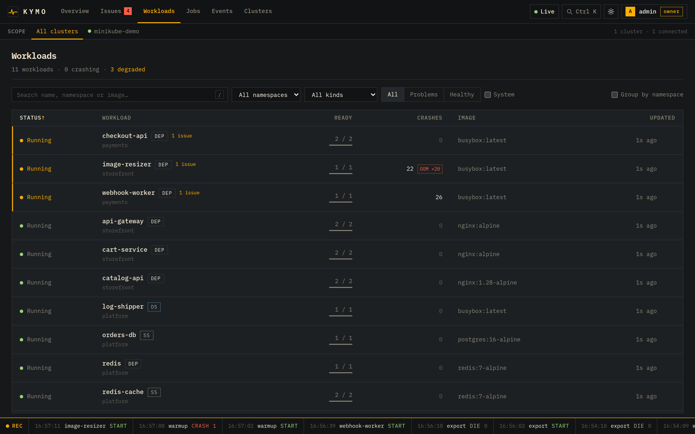<br><sub>Workloads with stability scores</sub></td>
    <td width="50%">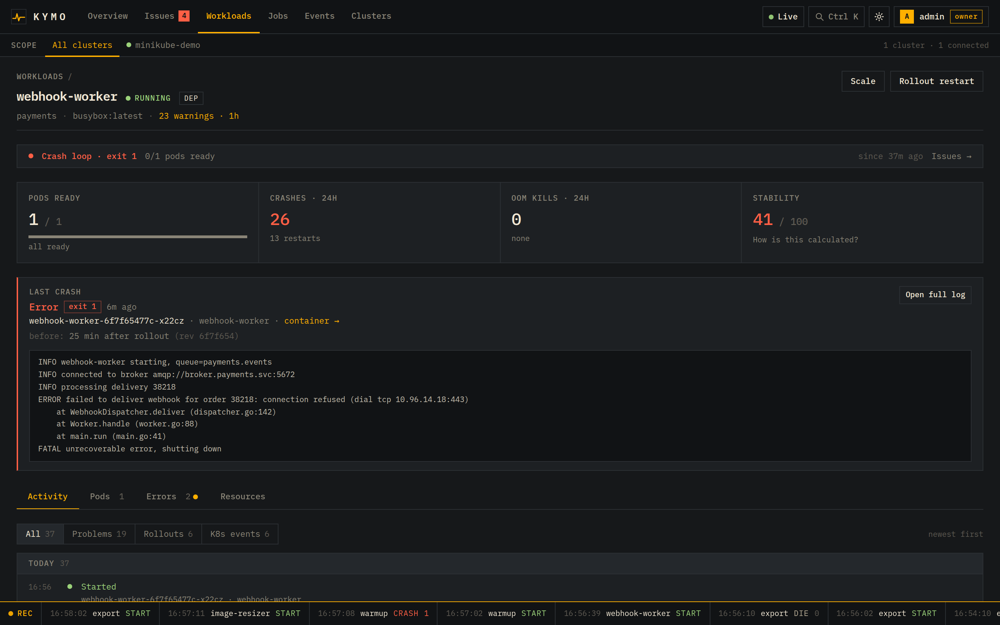<br><sub>Crash loop with the last crash log</sub></td>
  </tr>
  <tr>
    <td width="50%">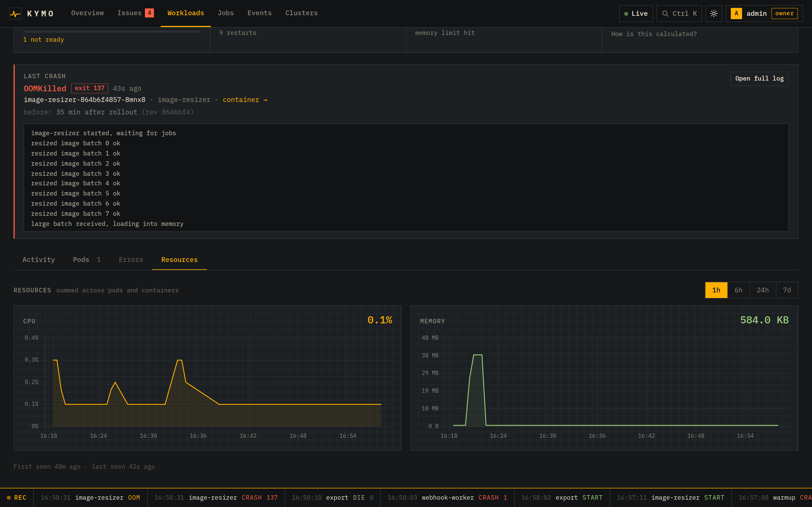<br><sub>CPU and memory</sub></td>
    <td width="50%">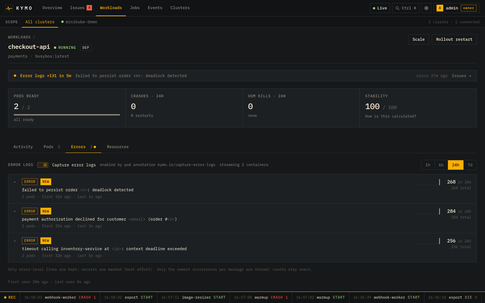<br><sub>Captured error signatures</sub></td>
  </tr>
  <tr>
    <td width="50%">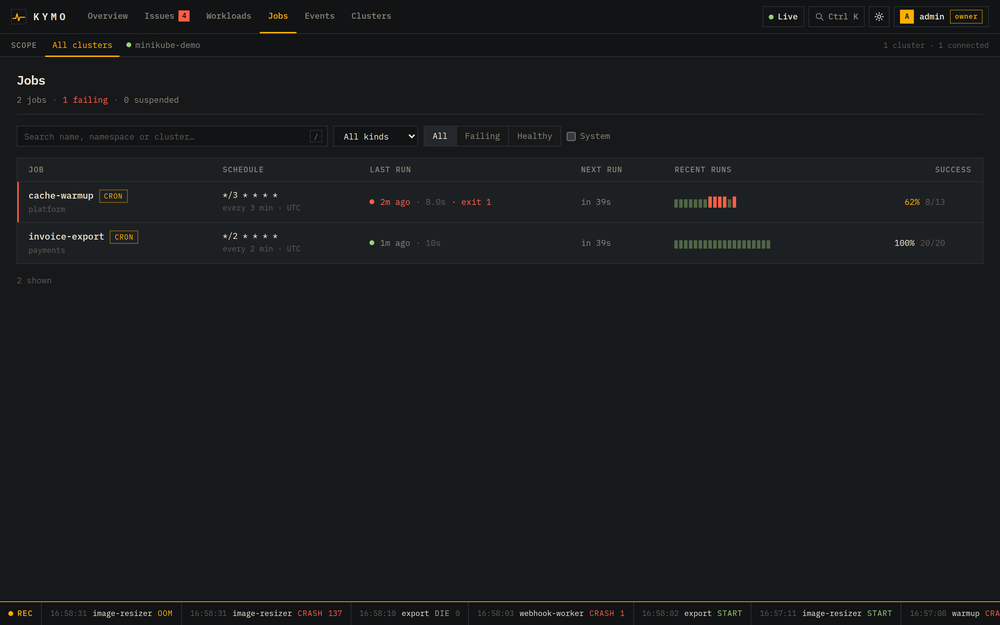<br><sub>CronJobs with run history and success rate</sub></td>
    <td width="50%">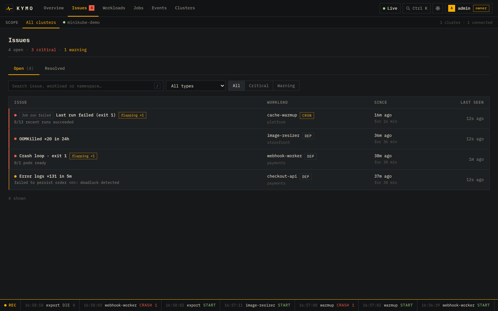<br><sub>Issues</sub></td>
  </tr>
  <tr>
    <td width="50%">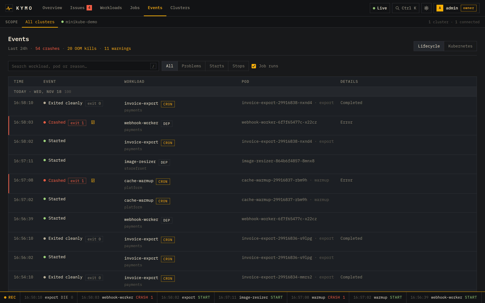<br><sub>Kubernetes events</sub></td>
    <td width="50%">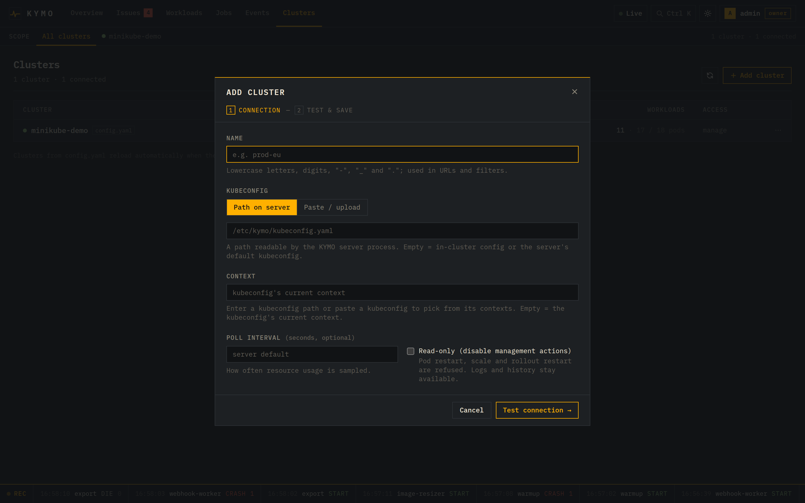<br><sub>Adding a cluster</sub></td>
  </tr>
  <tr>
    <td colspan="2">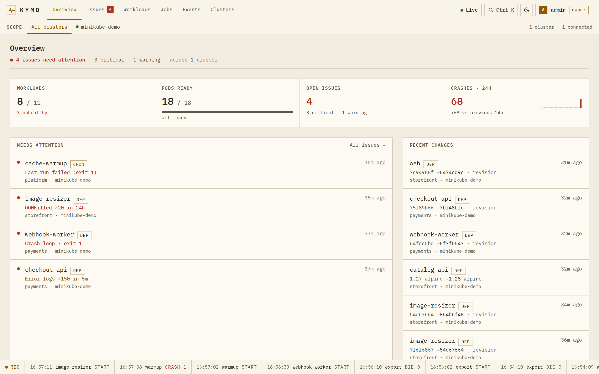<br><sub>Light theme</sub></td>
  </tr>
</table>

## Quick start

### Docker Compose

Runs KYMO and TimescaleDB. KYMO itself then connects to whichever Kubernetes clusters you add.

```bash
export KYMO_SECRET_KEY=$(openssl rand -hex 32)   # keep it: it decrypts stored kubeconfigs
docker compose up -d --build
docker compose logs kymo | grep "initial admin"  # one-time password for user "admin"
```

Open <http://localhost:8080>, sign in as `admin` and change the password. With no sources configured KYMO starts empty: add a cluster on the Clusters page by uploading a kubeconfig. To declare sources in a file instead, mount a `config.yaml` as shown in the commented `volumes` block of [`docker-compose.yml`](docker-compose.yml).

To choose the admin account yourself, set `KYMO_ADMIN_PASSWORD` (12+ characters) and optionally `KYMO_ADMIN_USERNAME` before the first start.

### Kubernetes (Helm)

The chart runs KYMO inside the cluster it monitors, using the pod's ServiceAccount. It installs a read-only ClusterRole and a bundled single-node TimescaleDB.

```bash
helm install kymo deploy/helm/kymo -n kymo --create-namespace

# initial admin password (generated into the release Secret)
kubectl -n kymo get secret kymo -o jsonpath='{.data.admin-password}' | base64 -d

kubectl -n kymo port-forward svc/kymo 8080:8080   # http://localhost:8080
```

The chart pulls `ghcr.io/emirhanusta/kymo`, which the release workflow publishes for `v*` tags (linux/amd64 and arm64). To try a local build on minikube, build the image into the cluster and skip pulling:

```bash
minikube image build -t ghcr.io/emirhanusta/kymo:0.1.0 .
helm install kymo deploy/helm/kymo -n kymo --create-namespace --set image.pullPolicy=Never
```

CPU and memory sampling needs metrics-server in the monitored cluster. External databases, ingress, SSO, notification channels and management RBAC are covered in the [chart README](deploy/helm/kymo/README.md).

## Configuration

KYMO reads `config.yaml` (see [`config.example.yaml`](config.example.yaml) for every key). Any key can be overridden with an environment variable prefixed `KYMO_`, with nesting as underscores.

| Setting | Env var | Purpose |
|---|---|---|
| `database.dsn` | `KYMO_DATABASE_DSN` | TimescaleDB connection string. Migrations run at startup. |
| `secret_key` | `KYMO_SECRET_KEY` | Encrypts uploaded kubeconfigs and notification URLs. Must stay stable. |
| `server.public_url` | `KYMO_SERVER_PUBLIC_URL` | External URL, used in notification links. Required for SSO. |
| `collector.sources` | | Kubernetes clusters to watch. `kubeconfig_path: "in-cluster"` selects the pod's ServiceAccount. |
| `collector.stats_poll_interval` | `KYMO_COLLECTOR_STATS_POLL_INTERVAL` | CPU/memory sampling interval. |
| `collector.scoring_window` | `KYMO_COLLECTOR_SCORING_WINDOW` | Window used for the stability score. |
| `collector.crash_logs.*` | | Crash-log capture on or off, tail lines, size limit. |
| `log_capture.*` | | Error-log capture targets, limits, patterns and retention. |
| `issues.*` | | Error-rate threshold, degraded and resolve delays, reopen window. |
| `notifications.channels` | | Channels declared in the file (locked in the UI). |
| `auth.enabled` | `KYMO_AUTH_ENABLED` | Sign-in requirement. Disable only on a local machine. |
| `auth.oidc.*` | `KYMO_AUTH_OIDC_CLIENT_SECRET` | OpenID Connect provider, group-to-role mapping. |
| | `KYMO_ADMIN_USERNAME`, `KYMO_ADMIN_PASSWORD` | Initial admin account, used only while there are no users. |

The source list, notification channels and `log_capture` settings are hot-reloaded when the file changes. Other settings need a restart.

## Architecture

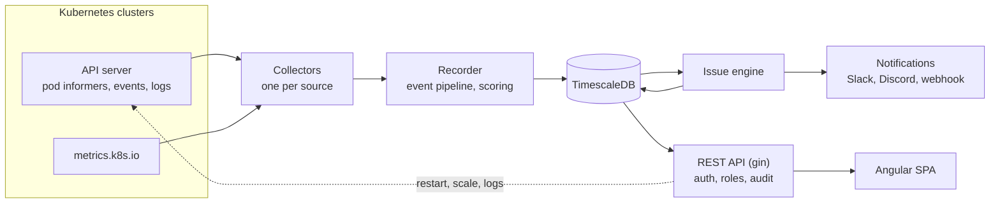

**Design decisions**

- **Workload identity.** A workload is identified as `source:namespace:Kind:name`, for example `prod:shop:Deployment:checkout`. Containers, scores, issues, events and errors all hang off this id, which is what lets history survive pod replacement.
- **Pod-level and workload-level views.** Collectors record raw per-pod, per-container events. The recorder aggregates them per workload, reading rollouts and scale-downs as stops and finished Job pods as completions, so only genuine failures count as crashes.
- **TimescaleDB.** Events, resource samples, Kubernetes events, crash logs and error counts are hypertables with retention policies. Resource data is rolled up into a 5-minute continuous aggregate, and long ranges are downsampled server-side.
- **Read-only by default.** The Helm chart grants cluster-wide read access only. Management actions need extra RBAC (`rbac.management.enabled`), and any source can be marked read-only so the UI refuses to act on it.
- **Single writer.** One KYMO instance records into one database, so the chart runs a single replica.

## Security

Authentication is on by default. One installation is one organisation, and roles are global.

| Role | Can |
|---|---|
| viewer | Read everything: overview, workloads, issues, errors, logs, clusters. |
| operator | Viewer, plus restart pods, scale and rollout-restart, ignore containers, toggle log capture. |
| admin | Operator, plus manage clusters, notification channels, users, invites, other people's API tokens, and read the audit log. |
| owner | Admin, plus promote and demote admins and transfer ownership. There is exactly one owner. |

- Passwords are stored as argon2id hashes. Sessions use an HttpOnly, SameSite=Lax cookie with sliding and absolute expiry, and are revoked on password, role or status change.
- OIDC uses the authorization-code flow with PKCE, state and nonce. With `role_mapping`, roles are synced from a groups claim at each login.
- Mutating requests require a custom header and a matching `Origin`. Login attempts are rate-limited per IP and per account. Sensitive actions are written to the audit log.
- API tokens (`Authorization: Bearer kymo_...`) are shown once and never exceed the creator's role.
- Webhook secrets and uploaded kubeconfigs are encrypted at rest with `KYMO_SECRET_KEY`.
- Lockout recovery from the server: `kymo admin reset-password --username admin` (in a container: `/kymo admin reset-password ...`).
- Log capture masks tokens, passwords, keys, JWTs and URL credentials on a best-effort basis. Enable it only for workloads whose logs you are allowed to store.

The full model is described in [`docs/design/accounts.md`](docs/design/accounts.md).

## Development

Prerequisites: Go 1.25, Node 22, Docker (for TimescaleDB and the database tests).

```bash
docker compose up -d timescaledb     # database on localhost:5432
cp config.example.yaml config.yaml   # set the DSN and sources
make web                             # build the UI into frontend/dist
make run                             # API and collectors (set server.static_dir to serve the UI)

make web-dev                         # Angular dev server on :4200, proxies /api to :8080
```

| Target | Description |
|---|---|
| `make run` / `make build` | Run the service or compile the binary into `bin/` |
| `make web` / `make web-dev` | Build the frontend or start the dev server |
| `make test` | `go test -race ./...` |
| `make test-db` | Repository integration tests against a throwaway TimescaleDB container (needs Docker) |
| `make lint` | `golangci-lint` |
| `make migrate DSN=...` | Apply migrations by hand (the service also does this at startup) |
| `make docker-up` / `make docker-down` | Start or stop the Compose stack |

The repository integration tests skip unless `KYMO_TEST_DSN` is set, so plain `go test ./...` stays fast. CI runs formatting, vet, unit tests, database tests, the frontend build, the image build and Helm lint on every pull request.

```
cmd/kymo               entry point and "admin" CLI
internal/auth          sessions, passwords, OIDC, tokens, CSRF, rate limiting
internal/collector     Kubernetes informers and samplers
internal/service       recorder, scoring, issues, notifications, error logs, management
internal/errorlog      error detection, normalization, masking, grouping
internal/repository    TimescaleDB persistence and migration runner
internal/handler       REST API (/api/v1) and SPA serving
migrations             SQL schema, embedded into the binary
frontend               Angular web UI
deploy/helm/kymo       Helm chart
docs/design            design notes
```

## Roadmap

From the later phases in [`docs/design/accounts.md`](docs/design/accounts.md):

- Auth proxy mode, trusting `X-Forwarded-Email` from oauth2-proxy within a trusted CIDR
- SMTP delivery for invites and password resets
- Optional TOTP two-factor authentication for local accounts
- Per-cluster role bindings with filtered queries

Docker and other runtimes are not supported; KYMO currently records Kubernetes only.

## License

KYMO is licensed under the [Apache License 2.0](LICENSE).
