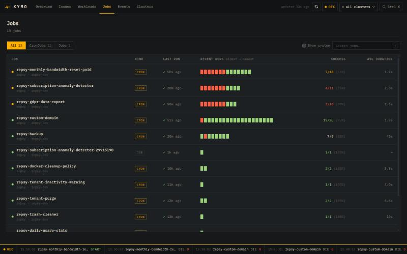

# KYMO

[](https://github.com/emirhanusta/kymo/actions/workflows/ci.yml)

A recorder for container lifecycles. KYMO watches Kubernetes clusters
(Kubernetes-only for now), records every start, crash, OOM kill and resource sample in
TimescaleDB, and turns that history into a stability score per container —
like a kymograph tracing a needle over chart paper.


## What it does

- **Workload-level history** — every pod a Deployment, StatefulSet, DaemonSet,
  CronJob or Job ever ran is aggregated into one workload, so crashes, OOM
  kills, restarts and the stability score survive rollouts and rescheduling.
  Pods killed by a rollout or scale-down are recorded as stops, not crashes.
- **Lifecycle history** — start / stop / crash / OOM events per container,
  with exit codes and reasons, kept across restarts of KYMO itself.
- **Resource traces** — CPU, memory and network rates over 1h / 6h / 24h / 7d
  (long ranges are downsampled server-side).
- **Stability score (0–100)** — penalties for restarts, crashes, OOM kills,
  CPU volatility and reporting gaps over a configurable window.
- **Sources from the UI** — add, edit, pause and remove Kubernetes
  clusters at runtime, with a connection test before saving. Mark a
  source read-only to disable every management action for it. Unreachable
  sources are retried in the background and shown as such.
- **Management** — restart (delete) pods, scale and restart Deployments,
  stream pod logs.
- **Kubernetes extras** — workload detection (Deployment, Job, CronJob, …) and
  CronJob execution history.
- **Archive / ignore** — hide containers without losing their history, or stop
  tracking them entirely.

| | |
|---|---|
|  |  |
|  |  |

## Quick start (Docker Compose)

```bash
export KYMO_SECRET_KEY=$(openssl rand -hex 32)   # keep it; needed to decrypt stored kubeconfigs
docker compose up -d --build
```

This starts TimescaleDB and KYMO (the compose file only runs KYMO itself; it
does not monitor Docker). Open <http://localhost:8080>. With no sources
configured KYMO starts empty — add a Kubernetes source on the **Sources**
page by pasting a kubeconfig (requires `KYMO_SECRET_KEY`). Alternatively mount
a `config.yaml` at `/etc/kymo/config.yaml` plus the kubeconfig it references
(see the commented `volumes` in `docker-compose.yml` and
[`config.example.yaml`](config.example.yaml)).

## Running locally

Requirements: Go 1.24+, Node 20+, a TimescaleDB instance.

```bash
cp config.example.yaml config.yaml   # adjust sources / DSN
make web                             # build the UI into frontend/dist
make run                             # API + collectors (set server.static_dir to serve the UI)
```

For frontend development run `make web-dev` (Angular dev server on :4200,
proxying `/api` to :8080). Database migrations are applied automatically on
startup; `make migrate DSN=...` applies them by hand.

## Configuration

Only Kubernetes sources are supported for now; a source of any other type is
rejected. With no sources configured KYMO starts empty. Sources can be
declared in `config.yaml` (locked in the UI) or managed on the
**Sources** page. You can point at a kubeconfig file on the
server, or paste/upload one — uploads are stored encrypted and require
`KYMO_SECRET_KEY` to be set.

**Live reload:** the `collector.sources` list in `config.yaml` is applied while
KYMO runs — the file is watched, and you can also press *Reload config.yaml* on
the Sources page or `POST /api/v1/sources/reload`. Added, changed and removed
sources take effect immediately (recorded history is kept); an invalid file is
rejected and the current sources keep running. All other settings (server,
database, log, secret key, poll and scoring intervals) still need a restart.

See [`config.example.yaml`](config.example.yaml). Every key can be overridden
with an environment variable prefixed `KYMO_`, e.g. `KYMO_DATABASE_DSN`,
`KYMO_COLLECTOR_SCORING_WINDOW`.

Kubernetes sources need a kubeconfig; CPU/memory sampling requires
metrics-server in the cluster.

**Crash-log snapshots:** when a container crashes or is OOM-killed (not on
pod deletion or clean exit), KYMO fetches the tail of that container
instance's logs and stores it for 30 days, so you can see what it printed
before it died. Configure with `collector.crash_logs.enabled` (default
`true`), `collector.crash_logs.tail_lines` (default 200, max 2000) and
`collector.crash_logs.max_bytes` (default 65536, max 1 MiB). Logs can contain
sensitive data — set `enabled: false` to disable. The source's kubeconfig needs
`get` on `pods/log`. API: `GET /api/v1/workloads/:id/crash-logs`,
`GET /api/v1/containers/:id/crash-logs[?occurred_at=...]`.

**Kubernetes Events:** events expire in the cluster after about an hour, so
KYMO persists them (90 days) and links each to its workload where it can (Pod,
ReplicaSet, Deployment, StatefulSet, DaemonSet, Job, CronJob). `Warning` events
are always kept; `Normal` events only for the reasons in
`collector.k8s_events.normal_reasons` (default: ScalingReplicaSet,
SuccessfulCreate, SuccessfulDelete, Killing, SawCompletedJob, SuccessfulRescale,
Preempted, Rebooted, NodeNotReady, RegisteredNode, RemovingNode, Evicted).
`collector.k8s_events.enabled` (default `true`) and
`collector.k8s_events.exclude_namespaces` (default none) control the rest. The
source's kubeconfig needs `list` and `watch` on `events` (core API group,
cluster-wide). API: `GET /api/v1/k8s-events[?source&namespace&type&reason&workload_id&q&since&before&limit]`,
`GET /api/v1/workloads/:id/k8s-events`, `GET /api/v1/k8s-events/reasons[?source&since]`.

**Revisions:** each container records its pod's revision
(`pod-template-hash`, `controller-revision-hash`, or the Job name);
`GET /api/v1/workloads/:id/revisions` lists rollouts newest first.

> **Security note:** the API has no authentication and exposes management
> actions (delete pod, scale, rollout restart). Run it on a trusted network or behind an
> authenticating proxy, and be careful which kubeconfig context a source uses.

## Keyboard

| Key | Action |
|---|---|
| `⌘K` / `Ctrl+K` | Command palette — jump to any page or container |
| `1`–`6` | Switch tabs |
| `/` | Focus the search box |
| `Esc` | Close dialogs |

## Project layout

```
cmd/kymo            entry point
internal/collector  Kubernetes collector
internal/service    recorder (event pipeline, scoring loop) and management actions
internal/repository TimescaleDB persistence + embedded migration runner
internal/handler    REST API (/api/v1) and SPA serving
migrations          SQL schema (embedded into the binary)
frontend            Angular web UI
```

## Development

```bash
make test    # go test -race ./...
make lint    # golangci-lint
make test-db # repository integration tests against a throwaway TimescaleDB (needs Docker)
```

The integration tests in `internal/repository/timescale` skip unless
`KYMO_TEST_DSN` is set, so plain `go test ./...` stays fast. `make test-db`
starts a disposable `timescale/timescaledb` container on port 55433, runs the
tests against it and always removes the container. To use your own server, set
`KYMO_TEST_DSN` to a DSN whose user may `CREATE DATABASE`; each run creates and
drops its own `kymo_test_<random>` database and never touches any other.
